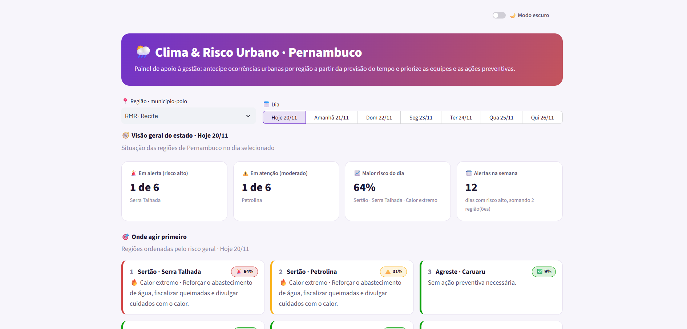
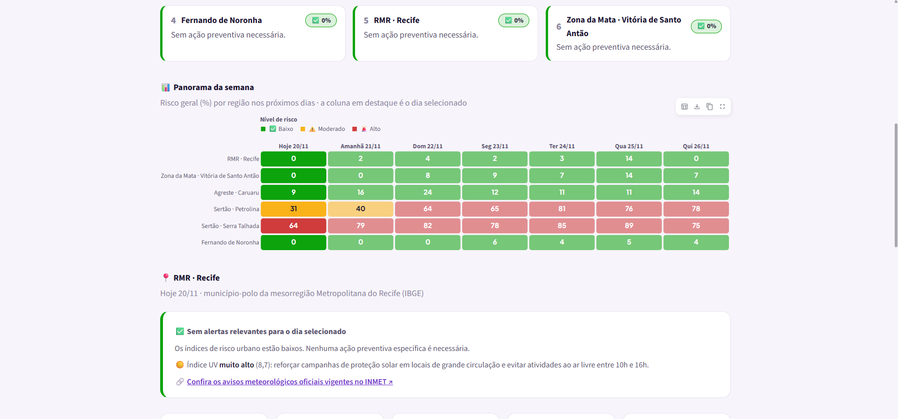
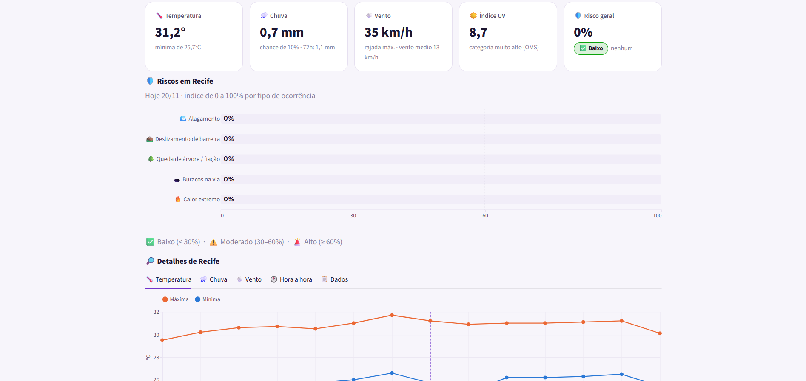
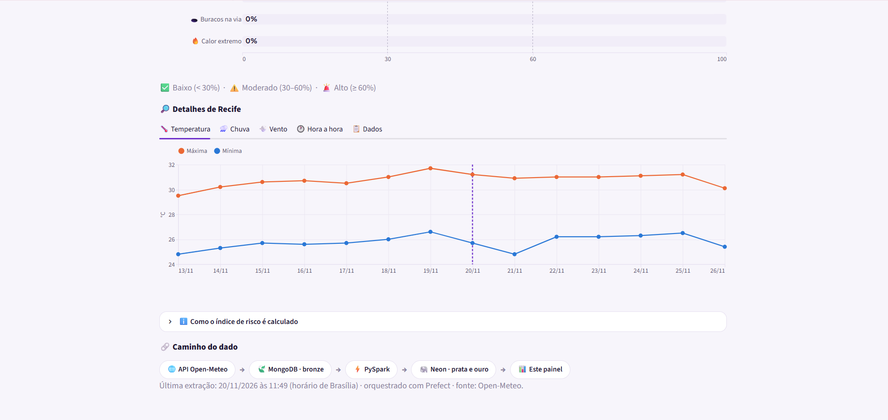

# 🌤️ Pipeline ETL - Previsão Meteorológica (Open-Meteo)

## 🎯 Objetivo

Este repositório foi criado para a construção de uma pipeline de **Engenharia de Dados** desenvolvida ao longo do semestre letivo.

O objetivo principal é aplicar os conhecimentos da disciplina através da implementação de um fluxo completo de ETL (*Extract, Transform, Load*) em Python, utilizando Orientação a Objetos para coletar, tratar e armazenar dados de previsão meteorológica.

Os dados tratados **enriquecem o app de denúncias urbanas do grupo (resolve-app)**: além da previsão do tempo, a pipeline calcula **índices de risco urbano** (alagamento, deslizamento, queda de árvore, buracos e calor) por região de **Pernambuco** e dia. Esses dados chegam ao app por meio de um **dashboard para o gestor público**, acessado de dentro do resolve-app, que mostra o clima e o risco nas mesmas regiões das denúncias.

> ℹ️ **Nota:** Este repositório é evolutivo e vem sofrendo alterações contínuas mediante a exposição a novos conhecimentos e práticas de Engenharia de Dados.

---

## 🔄 Fluxo da Pipeline ETL

Todo o fluxo é orquestrado pelo **Prefect** (`orchestrate_prefect.py`).

```text
                 ┌─────────────────────┐
                 │   API Open-Meteo    │
                 └──────────┬──────────┘
                            │  requests
                            ▼
                 ┌─────────────────────┐
                 │ BRONZE · MongoDB    │
                 │ JSON bruto (upsert) │
                 └──────────┬──────────┘
                            │  carga mais recente
                            ▼
                 ┌─────────────────────┐
                 │  Transformação      │
                 │  PySpark            │
                 └──────────┬──────────┘
                            │  upsert
                            ▼
 ┌──────────────────────────────────────────────────┐
 │ Neon DB (PostgreSQL)                             │
 │  PRATA: forecast_daily · forecast_hourly         │
 │  OURO:  urban_risk_daily · dimensão: dim_city    │
 └──────────────────────────┬───────────────────────┘
                            │
                            ▼
                 ┌─────────────────────┐
                 │ Dashboard do gestor │
                 │ (Streamlit)         │
                 └──────────┬──────────┘
                            │  link no app
                            ▼
                 ┌─────────────────────┐
                 │    resolve-app      │
                 └─────────────────────┘
```

O fluxo roda pelo **Prefect**, manualmente ou agendado (localmente ou no **GitHub Actions**, sem depender do computador ligado).

### 1. Extract — Extração dos dados

**Fonte:** API Open-Meteo Forecast.

Requisições HTTP com `requests` para cada localidade. Cada resposta traz **7 dias passados + 7 dias de previsão** (`past_days=7`). Os dias passados dão histórico ao banco e permitem calcular a chuva acumulada.

| Tipo | Tabela | Variáveis |
|---|---|---|
| Diária | `forecast_daily` | temperatura máx./mín. (`temperature_2m_max/min`), índice UV (`uv_index_max`), chuva do dia (`precipitation_sum`, `rain_sum`), chance máxima de chuva (`precipitation_probability_max`), vento e rajada máximos (`wind_speed_10m_max`, `wind_gusts_10m_max`) |
| Horária | `forecast_hourly` | temperatura (`temperature_2m`), chance de chuva (`precipitation_probability`), chuva na hora (`precipitation`), vento e rajada (`wind_speed_10m`, `wind_gusts_10m`) |

Os índices de risco (`urban_risk_daily`) são calculados a partir da tabela **diária**.

### 2. Bronze — MongoDB Atlas

O JSON retornado pela API é gravado como veio, acrescido de `cidade` e `data_extracao` (UTC), nas coleções `OPEN_METEO.WEATHER_DAILY` e `OPEN_METEO.WEATHER_HOURLY`.

* Cada extração vira um documento novo, então o bronze guarda o histórico de todas as cargas.
* **Índice único em `(cidade, data_extracao)`** e gravação com upsert (`ReplaceOne(..., upsert=True)`). Se a mesma extração for reenviada (por exemplo, num retry do Prefect), ela não é duplicada.

### 3. Transform — PySpark

Arquivo: `src/transform.py` (classe `Transform`). O Spark lê do Mongo a **carga mais recente de cada cidade**.

**Prata (`forecast_daily`, `forecast_hourly`)**
* O JSON é lido com **schema explícito** (`from_json`), montado a partir das variáveis pedidas à API.
* As listas paralelas da API (`time`, `temperature_2m_max`, ...) viram linhas com `arrays_zip` + `explode`. Nenhuma linha é removida e nulos continuam nulos (sem `dropna`, sem `fillna(0)`).
* Tipagem: `date` (DATE) no diário e `time` (TIMESTAMP, horário local de Brasília) no horário.
* `dropDuplicates` pela chave primária, para garantir que o lote não repita chaves.
* Validação no flow: o número de linhas por cidade na prata precisa ser igual ao do bronze. Caso contrário, o flow falha.

**Ouro (`urban_risk_daily`)**
* Chuva acumulada em **72h** e em **7 dias** com funções de janela (`Window.partitionBy("city").orderBy("date")`).
* `is_forecast`: indica se o dia é previsão (a partir de hoje) ou um dos dias passados.
* Índices de risco de 0 a 100, que crescem de forma linear entre um limiar inicial e um limiar máximo:

| Risco | Variável | 0% em | 100% em | Referência |
|---|---|---:|---:|---|
| Alagamento | chuva do dia | 10 mm | 100 mm | INMET: 50 mm/dia = perigo, 100 mm/dia = grande perigo |
| Deslizamento | chuva acumulada 72h | 50 mm | 150 mm | limiar aproximado para áreas de morro |
| Queda de árvore / fiação | rajada de vento | 40 km/h | 100 km/h | INMET: 40–60 km/h perigo potencial, >100 km/h grande perigo |
| Buracos na via | chuva acumulada 7 dias | 50 mm | 200 mm | limiar aproximado |
| Calor extremo | temperatura máxima | 32 °C | 40 °C | limiar aproximado |

* `risco_geral` (o maior dos riscos), `risco_principal` (qual deles) e `nivel_risco` (baixo < 30 ≤ moderado < 60 ≤ alto).

> ℹ️ **Nenhum dado vem do INMET.** Todos os dados meteorológicos vêm da Open-Meteo. Do INMET usamos apenas os **critérios públicos dos avisos meteorológicos** (amarelo = perigo potencial, laranja = perigo, vermelho = grande perigo), escritos como constantes no código para definir em que ponto cada risco começa e em que ponto chega a 100%.

> ⚠️ Os índices são **heurísticos**, baseados em limiares de alerta. Eles não são probabilidades medidas, já que a pipeline não usa dados de denúncias. Os limiares ficam em `LIMIARES` (`src/config.py`), compartilhados pelo Spark e pelo dashboard, e podem ser calibrados.

### 4. Load — Neon (PostgreSQL)

Arquivo: `src/load.py` (classe `Loading`).

* As tabelas são criadas pela função `Loading.create_schema()` com DDL explícito, **chave primária** e tipos definidos (`CREATE TABLE IF NOT EXISTS`).
* A carga é feita com **upsert** (`INSERT ... ON CONFLICT DO UPDATE`). Rodar a pipeline de novo atualiza as linhas existentes, sem duplicar, e os dias passados vão se acumulando como histórico.

| Tabela | Camada | Chave primária |
|---|---|---|
| `dim_city` | dimensão | `city` |
| `forecast_daily` | prata | `(city, date)` |
| `forecast_hourly` | prata | `(city, time)` |
| `urban_risk_daily` | ouro | `(city, date)` |

---

## 🌍 Parâmetros e Cobertura

### Horizonte

**7 dias passados + 7 dias de previsão**, a partir do dia da execução.

### Fuso horário

```text
America/Sao_Paulo (GMT-3)
```

### Localidades

A pipeline cobre as **5 regiões de Pernambuco usadas no resolve-app**. O cadastro fica em `Extract.CIDADES` (`src/extract.py`) e vira a tabela `dim_city` no Neon.

#### Por que um município por região?

A Open-Meteo responde por **ponto** (latitude/longitude), e não por área: não existe uma consulta do tipo "previsão do Agreste". Por isso, cada **mesorregião do IBGE** de Pernambuco é representada por um **município-polo**, uma cidade central e populosa da região, cuja previsão é usada como referência para a região inteira.

> ⚠️ É uma aproximação. O clima varia dentro de uma mesma região (por exemplo, o litoral e o interior da Zona da Mata). Para mais precisão, seria possível consultar vários pontos por região e tirar a média.

#### Mesorregião (IBGE) × região do app

Cada localidade tem duas classificações na `dim_city`:

* `mesorregiao`: divisão oficial do IBGE, usada para escolher os pontos;
* `regiao`: região usada no **resolve-app** (RMR, Zona da Mata, Agreste, Sertão e Fernando de Noronha), usada como filtro no produto.

| Mesorregião (IBGE) | Região no app | Município-polo |
| --- | --- | --- |
| Metropolitana do Recife | RMR | Recife |
| Mata Pernambucana | Zona da Mata | Vitória de Santo Antão |
| Agreste Pernambucano | Agreste | Caruaru |
| Sertão Pernambucano | Sertão | Serra Talhada |
| São Francisco Pernambucano | Sertão | Petrolina |
| Metropolitana do Recife (microrregião de Fernando de Noronha) | Fernando de Noronha | Fernando de Noronha |

* **Sertão:** o app trata como uma região só, mas o IBGE divide em duas mesorregiões (Sertão e São Francisco). Mantemos os dois pontos, então o Sertão no app tem duas previsões: Serra Talhada (Sertão do Pajeú) e Petrolina (Vale do São Francisco).
* **Fernando de Noronha:** para o IBGE, faz parte da mesorregião Metropolitana do Recife. Mas é um arquipélago a cerca de 350 km da costa, com clima oceânico próprio, então ganhou um ponto separado, que corresponde à região "Fernando de Noronha" do app.

#### Todas as localidades

| city | UF | Mesorregião (IBGE) | Região (app) | Latitude | Longitude |
| --- | :-: | --- | --- | --: | --: |
| recife | PE | Metropolitana do Recife | RMR | -8.0492 | -34.9231 |
| vitoria_de_santo_antao | PE | Mata Pernambucana | Zona da Mata | -8.1181 | -35.2914 |
| caruaru | PE | Agreste Pernambucano | Agreste | -8.2760 | -35.9819 |
| serra_talhada | PE | Sertão Pernambucano | Sertão | -7.9858 | -38.2958 |
| petrolina | PE | São Francisco Pernambucano | Sertão | -9.3891 | -40.5030 |
| fernando_de_noronha | PE | Metropolitana do Recife | Fernando de Noronha | -3.8547 | -32.4247 |

---

## ⚙️ Configuração do Ambiente

### 1. Java (necessário para o Spark)

Python **3.11 ou mais recente** (testado no 3.14). O PySpark 4 precisa de um **JDK 17 ou 21** instalado, com `JAVA_HOME` configurado. No Windows, por exemplo:

```powershell
winget install EclipseAdoptium.Temurin.21.JDK
```

Depois, abra um terminal novo e confira com `java -version`.

> No Windows, o `spark-submit` falha quando o caminho do projeto tem acento ou espaço (ex.: `C:\Users\Cecília`). O `Transform` contorna isso sozinho, usando o caminho curto do Windows (`C:\Users\CECLIA~1\...`).

### 2. Criando e ativando o ambiente virtual

```bash
python -m venv venv
```

#### Windows PowerShell

```powershell
venv\Scripts\Activate.ps1
```

#### Linux / Mac

```bash
source venv/bin/activate
```

### 3. Instalando as dependências

```bash
pip install -r requirements.txt
```

---

## 🔐 Variáveis de Ambiente (.env)

O arquivo `.env` é lido **uma única vez** por `src/config.py`, e todos os módulos importam as variáveis de lá (`from src import config`), sem usar `os.getenv` diretamente.

```env
MONGODB_URI="sua_string_de_conexao_mongodb_atlas"
DATABASE_URL="sua_string_de_conexao_postgresql_neon"
```

`MONGODB_URI` e `DATABASE_URL` são obrigatórias, mas cada uma só é exigida quando é usada: se faltar, o `config.py` interrompe a execução com uma mensagem clara. Assim, a pipeline usa as duas, e o dashboard publicado precisa apenas do `DATABASE_URL`.

### Estrutura do projeto

```text
📁 projeto/
├── 📁 .github/workflows/
│   └── etl.yml             # agendamento da pipeline no GitHub Actions
├── 📁 .streamlit/
│   └── config.toml         # tema base do dashboard
├── 📁 dashboard/
│   ├── app.py              # produto (Streamlit), lê do Neon
│   └── requirements.txt    # dependências só do dashboard (sem Spark/Prefect)
├── 📁 src/
│   ├── config.py           # credenciais (.env) e limiares do índice de risco
│   ├── extract.py          # localidades, API Open-Meteo e leitura do bronze
│   ├── transform.py        # PySpark: bronze -> prata e ouro
│   └── load.py             # schema do Neon, Mongo (bronze), Neon (upsert)
├── 📄 orchestrate_prefect.py
├── 📄 runETL.py            # atalho para o flow
├── 📄 verificacao.py
├── 📄 requirements.txt
├── 📄 .env.example
├── 📄 .gitignore
└── 📄 README.md
```
> ⚠️ **Importante:** Não compartilhe suas credenciais de banco de dados publicamente. O arquivo `.env` está no `.gitignore` para que suas informações de acesso não sejam enviadas ao GitHub.

---

## ▶️ Execução da Pipeline

Com o Prefect (UI com o grafo do flow, status das tasks e logs em tempo real):

```bash
prefect server start
prefect config set PREFECT_API_URL=http://127.0.0.1:4200/api
python orchestrate_prefect.py
```

O `prefect server start` precisa estar rodando (em outro terminal) antes do `python orchestrate_prefect.py`.

### Agendamento (todo sábado às 9h, até 12/12/2026)

```bash
python orchestrate_prefect.py --agendar
```

O comando registra no Prefect o deployment `etl-semanal-sabado-9h`, com uma agenda `RRule` no fuso `America/Sao_Paulo` (sábados 21/11, 28/11, 05/12 e 12/12, às 9h), e fica aguardando os horários. A agenda e as próximas execuções aparecem na UI do Prefect, em **Deployments**.

> ⚠️ O Prefect em modo local é gratuito, mas só executa se o computador estiver ligado com o `prefect server start` e o `python orchestrate_prefect.py --agendar` abertos no horário. Sem a flag `--agendar`, o script roda a pipeline uma única vez, na hora.

### Automação no GitHub Actions (sem o computador ligado)

O arquivo `.github/workflows/etl.yml` roda a mesma pipeline nos servidores do GitHub, **todo sábado às 9h (Brasília) até 12/12/2026**, e também pode ser disparado na hora (aba **Actions → ETL semanal → Run workflow**). O workflow:

1. instala Java 21 e Python;
2. instala o `requirements.txt`;
3. roda `python orchestrate_prefect.py`, com o Prefect subindo um servidor temporário só durante a execução;
4. roda o `verificacao.py`.

Para funcionar, é preciso:
* cadastrar `MONGODB_URI` e `DATABASE_URL` em **Settings → Secrets and variables → Actions** do repositório;
* no MongoDB Atlas, em **Network Access**, liberar `0.0.0.0/0`, porque os IPs do GitHub mudam a cada execução;
* ter o workflow na branch padrão (`main`), já que agendamentos só rodam a partir dela.

> ℹ️ É gratuito para repositórios públicos (e há 2.000 minutos/mês para privados; cada execução leva poucos minutos). O GitHub pode atrasar execuções agendadas em alguns minutos.

Cada task abre e fecha as próprias conexões (`with Extract()` / `with Loading()` / `with Transform()`), e as tasks de I/O têm retries.

---
## ✅ Integridade dos dados (bronze → final)

O script `verificacao.py` compara o MongoDB (bronze) com o Neon (prata).

| Verificação | O que confere |
|---|---|
| Registros (última carga) | linhas por cidade na prata = tamanho das listas no bronze |
| Colunas | final = bronze + `city` + `data_extracao` |
| Nulos e zeros | os mesmos no bronze e na final (nulo continua nulo, zero continua zero) |
| Chaves duplicadas | 0 no bronze `(cidade, data_extracao)` e 0 na final (chave primária) → cargas idempotentes |
| Histórico | cargas acumuladas no bronze e dias/horas acumulados na final |

**Dado ausente:** a fonte é uma previsão gerada por modelos meteorológicos, que calculam todas as variáveis para todo ponto e horário. Não é uma medição de sensores que podem falhar, por isso normalmente não há ausentes. Mesmo assim, não há `dropna()` nem `fillna(0)`: um `null` é preservado como `NULL`, nunca como zero. Os índices de risco também ficam nulos quando a variável de origem é nula.

```bash
python verificacao.py
```
---

## 📊 Dashboard (Streamlit)

Painel voltado ao **gestor público**, para antecipar ocorrências urbanas e priorizar as ações preventivas. Ele **só lê do Neon** (`dim_city`, `forecast_daily`, `forecast_hourly` e `urban_risk_daily`), nunca da API, e só precisa da credencial `DATABASE_URL`.

* **Filtros:** região/município-polo e dia (próximos 7 dias), lado a lado. Botão de **modo claro/escuro**.
* **Visão geral do estado:** quantas regiões estão em alerta e em atenção, qual é o maior risco do dia e quantos alertas há na semana.
* **Onde agir primeiro:** ranking das regiões pelo risco do dia, em cartões de 3 por linha, com a **ação recomendada** para cada uma.
* **Panorama da semana:** todas as regiões × 7 dias.
* **Região selecionada:** aviso com as denúncias que podem estar relacionadas, a ação recomendada, o alerta de índice UV e o link para os avisos oficiais do INMET; indicadores do dia; e o índice de cada tipo de risco.
* **Detalhes:** temperatura, chuva, vento, hora a hora e tabela com download em CSV.
* **Metodologia** do índice e **caminho do dado** (API → Mongo → Spark → Neon → painel).
* Layout responsivo: no celular, as colunas viram uma lista vertical.

**Tecnologias do painel:** Streamlit (página e filtros), Altair/Vega-Lite (gráficos), Pandas + SQLAlchemy (leitura do Neon) e HTML/CSS próprios (cartões, avisos e tema claro/escuro).

### Como rodar

Com o ambiente virtual ativo e a pipeline já executada ao menos uma vez, execute **a partir da raiz do projeto**:

```bash
python -m streamlit run dashboard/app.py
```

O dashboard abre em `http://localhost:8501`.

### Publicação (Streamlit Community Cloud)

1. Em [share.streamlit.io](https://share.streamlit.io), conecte o GitHub e crie o app apontando para este repositório, branch `main`, arquivo **`dashboard/app.py`**.
2. Em **Advanced settings**, escolha Python 3.12 ou mais recente e cadastre em *Secrets*:
   ```toml
   DATABASE_URL = "postgresql://..."
   ```
3. O Streamlit Cloud instala o `dashboard/requirements.txt` (só o necessário para o painel, sem Spark e Prefect) e gera um link `https://<nome>.streamlit.app`, que pode ser aberto pelo resolve-app (link, WebView ou `?embed=true` em um iframe).

> ℹ️ No plano gratuito, o painel "dorme" após um período sem acesso. Quem abrir o link vê um botão para acordá-lo, e ele volta em menos de um minuto. Recomenda-se usar no `DATABASE_URL` um usuário do Neon **somente leitura**.






---

## 🛠️ Tecnologias Utilizadas

| Tecnologia                | Finalidade                                                                        |
| ------------------------- | --------------------------------------------------------------------------------- |
| **Python 3.11+**          | Linguagem principal da pipeline, com foco em Orientação a Objetos.                |
| **PySpark**               | Transformação bronze → prata → ouro (schema explícito, explode, janelas).         |
| **Prefect**               | Orquestração, agendamento semanal (RRule), retries, logs e monitoramento.         |
| **Requests**              | Requisições HTTP à API Open-Meteo.                                                |
| **MongoDB Atlas**         | Camada bronze: JSON bruto, com índice único por extração.                         |
| **PyMongo**               | Conexão e comunicação com o MongoDB Atlas.                                        |
| **NeonDB / PostgreSQL**   | Camadas prata e ouro, com chaves primárias e upsert.                              |
| **SQLAlchemy / psycopg2** | Conexão com o PostgreSQL e upsert (`ON CONFLICT DO UPDATE`).                      |
| **python-dotenv**         | Leitura do `.env`, centralizada em `src/config.py`.                               |
| **Streamlit / Altair**    | Dashboard interativo conectado ao Neon (gráficos em Vega-Lite).                   |
| **GitHub Actions**        | Execução agendada da pipeline na nuvem (sábados às 9h).                           |

---

## 📌 Conceitos Aplicados

* Arquitetura medalhão (bronze, prata e ouro).
* Extração de dados via API.
* Bancos NoSQL (bronze) e relacionais (prata/ouro).
* Cargas idempotentes (índice único no Mongo, chave primária e upsert no Postgres).
* Processamento com Spark (schema explícito, `explode`, funções de janela).
* Orquestração e agendamento com Prefect (tasks, retries, logs, deployment com agenda).
* Credenciais centralizadas fora do código (`.env` local, *Secrets* no GitHub e no Streamlit Cloud).
* Integração com o app do grupo: o dashboard, que lê do banco, é acessado de dentro do resolve-app.
* Validação de integridade entre camadas.
* Orientação a Objetos em Python.

---

## 👥 Integrantes

* Alvaro Silva
* Arthur Estevão
* Beatriz Paredes
* Cecília Medeiros
* Gabriel Souza
* Icaro Silva
* Isabella Batista
* Jose Leandro De Morais
* Melissa Filgueiras
* Thays Barbosa

---

## 📚 Sobre o Projeto

Projeto acadêmico desenvolvido ao longo do semestre letivo, com foco na aplicação prática dos conhecimentos de Engenharia de Dados através da construção de uma pipeline ETL utilizando Python, MongoDB Atlas, PySpark, Prefect e NeonDB.

**Status:** Em desenvolvimento contínuo 🚀

## Uso de Inteligência Artificial

Declaro que utilizei a ferramenta de Inteligência Artificial ChatGPT (modelo GPT-4o / GPT-4), Google Gemini (modelo Gemini 1.5 Pro) e Claude (modelo Claude Opus 5.5) ao longo dessa atividade, com a finalidade de gerar um rascunho sobre orquestração de pipelines de ETL, resiliência de workflows e boas práticas em Engenharia de Dados, sobre o qual realizei análise crítica (curadoria) das informações apresentadas. Não tratei dados pessoais no uso desta ferramenta. Revisei criticamente o conteúdo gerado, identificando seus acertos e eventuais imprecisões, e assumo a responsabilidade integral pela versão final apresentada.
